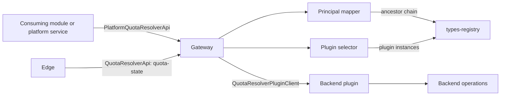
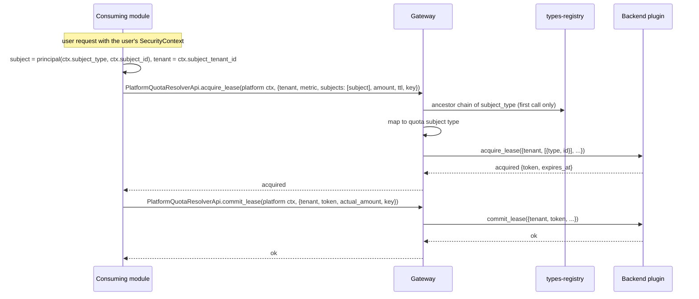
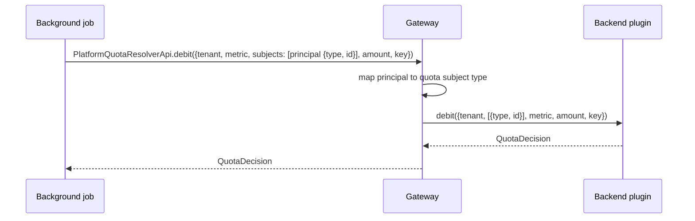
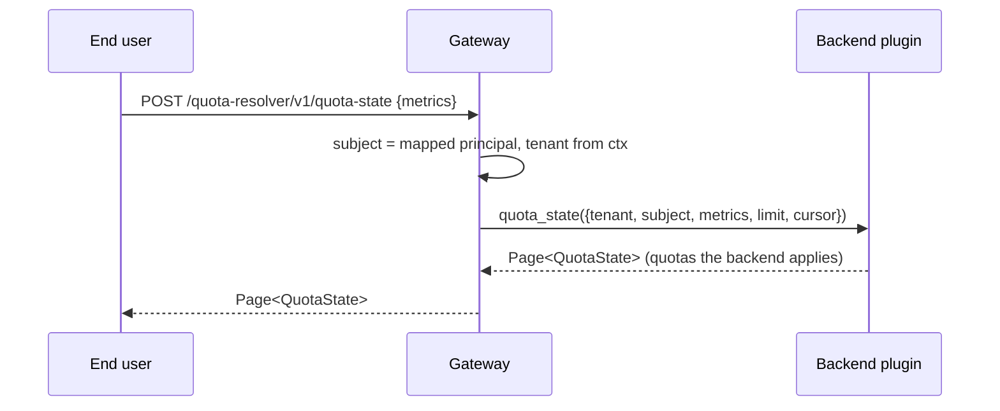

# Technical Design — Quota Resolver

<!-- toc -->

- [1. Architecture Overview](#1-architecture-overview)
  - [1.1 Architectural Vision](#11-architectural-vision)
  - [1.2 Architecture Drivers](#12-architecture-drivers)
  - [1.3 Architecture Layers](#13-architecture-layers)
- [2. Principles & Constraints](#2-principles--constraints)
  - [2.1 Design Principles](#21-design-principles)
  - [2.2 Constraints](#22-constraints)
- [3. Technical Architecture](#3-technical-architecture)
  - [3.1 Domain Model](#31-domain-model)
  - [3.2 Component Model](#32-component-model)
  - [3.3 API Contracts](#33-api-contracts)
  - [3.4 Internal Dependencies](#34-internal-dependencies)
  - [3.5 External Dependencies](#35-external-dependencies)
  - [3.6 Interactions & Sequences](#36-interactions--sequences)
  - [3.7 Database schemas & tables](#37-database-schemas--tables)
  - [3.8 Deployment Topology](#38-deployment-topology)
- [4. Additional context](#4-additional-context)
  - [4.1 Overhead Budget](#41-overhead-budget)
  - [4.2 Observability](#42-observability)
  - [4.3 Security](#43-security)
- [5. Traceability](#5-traceability)

<!-- /toc -->

- [ ] `p3` - **ID**: `cpt-cf-quota-resolver-design-main`

## 1. Architecture Overview

### 1.1 Architectural Vision

Quota Resolver is a stateless gateway with no store. It offers five operations (debit, lease acquisition, lease
commit, lease release, and quota state) on two planes, each its own contract, as types-registry does with
`PlatformTypesRegistryApi` and `TypesRegistryApi`:

* **platform plane**, `PlatformQuotaResolverApi`: all five operations. A trusted platform service names the tenant and
  the subjects. A module that charges the user of its request takes the user's principal and tenant from the incoming
  `SecurityContext` and passes them as request data; the user's context is neither forwarded nor synthesized;
* **tenant plane**, `QuotaResolverApi`: quota state only. The subject is the caller's principal and the tenant is the
  caller's tenant, both taken from `SecurityContext`.

The subject forms and the principal mapping are those of license-resolver.

For each call the gateway:

1. turns every subject into a quota subject, mapping a principal type to a quota subject type from configuration;
2. fixes the tenant;
3. selects a backend plugin;
4. delegates.

The plugin owns quotas, counters, leases, idempotency, and evaluation. A quota backend provides the plugin in process,
over its own operations.

The design keeps the resolver thin:

* It validates only what it produces: the subject forms and the mapping.
* The backend validates metrics, subject types, metadata, amounts, and idempotency keys against its own catalogue, so
  the resolver does not keep a second copy of that catalogue.
* The tenant-plane request type has no field for a subject or a tenant, so the caller cannot change them.

### 1.2 Architecture Drivers

#### Functional Drivers

| Requirement                                  | Design Response                                                                                              |
|----------------------------------------------|--------------------------------------------------------------------------------------------------------------|
| `cpt-cf-quota-resolver-fr-debit`             | `PlatformQuotaResolverApi.debit` delegates to the plugin and returns `QuotaDecision`.                        |
| `cpt-cf-quota-resolver-fr-lease`             | `acquire_lease`, `commit_lease`, `release_lease` on `PlatformQuotaResolverApi`; the plugin holds the lease and its expiry. |
| `cpt-cf-quota-resolver-fr-quota-state`       | `quota_state` on both contracts returns a page of `QuotaState`.                                              |
| `cpt-cf-quota-resolver-fr-idempotency`       | Every write request carries an idempotency key; the gateway passes it unchanged; the plugin replays.         |
| `cpt-cf-quota-resolver-fr-subject-forms`     | `SubjectInput` is a quota subject or a principal (§3.1).                                                     |
| `cpt-cf-quota-resolver-fr-principal-mapping` | Principal mapper (§3.2): exact entry, then nearest ancestor from types-registry; not mapped ends before the plugin. |
| `cpt-cf-quota-resolver-fr-platform-plane`    | `PlatformQuotaResolverApi` has every operation and takes `PlatformSecurityContext`; its routes are internal (§3.3). The SDK helper builds the principal subject and tenant from a user's `SecurityContext` as request data. |
| `cpt-cf-quota-resolver-fr-tenant-plane`      | `QuotaResolverApi` has only `quota_state`, takes `SecurityContext`, has no subject or tenant field, and is exposed. |
| `cpt-cf-quota-resolver-fr-plugin-delegation` | Plugin selector: types-registry discovery, vendor and priority, scoped ClientHub lookup.                     |

#### NFR Allocation

| NFR ID                                     | NFR Summary                       | Allocated To               | Design Response                                                                                                                                       | Verification Approach                                         |
|--------------------------------------------|-----------------------------------|----------------------------|-------------------------------------------------------------------------------------------------------------------------------------------------------|---------------------------------------------------------------|
| `cpt-cf-quota-resolver-nfr-fail-closed`    | Never allow by default            | Gateway, error mapping     | No plugin and a registry failure are errors; a plugin error passes through as an error; not mapped is a denial. No code path builds an allowed result. | Tests for each condition: no allowed decision, no lease.      |
| `cpt-cf-quota-resolver-nfr-tenant-scoping` | One tenant per operation          | Gateway                    | Platform plane: the tenant from the request. Tenant plane: `subject_tenant_id` from the context. The plugin receives exactly one tenant.          | Tests on both planes: the plugin receives the request's tenant (platform) or the caller's tenant (tenant plane), never another. |
| `cpt-cf-quota-resolver-nfr-overhead`       | ≤ 5 ms p95 added, plugin excluded | Principal mapper, selector | Budget in §4.1: in-memory map lookups, memoized plugin and ancestor chains; no network call on the warm path.                                          | Boundary benchmark with a no-op plugin.                       |

#### Key ADRs

| ADR ID                                                | Decision Summary                                                                                                  |
|-------------------------------------------------------|-------------------------------------------------------------------------------------------------------------------|
| `cpt-cf-quota-resolver-adr-plugin-delegation`         | No store; one plugin selected through types-registry; a quota backend implements it.                              |
| `cpt-cf-quota-resolver-adr-principal-subject-mapping` | Principal type → quota subject type from configuration; exact, then nearest ancestor; not mapped is denied.       |
| `cpt-cf-quota-resolver-adr-two-planes`                | Writes only on the trusted platform plane, principal as request data; read-only tenant plane at the edge. |

### 1.3 Architecture Layers

```text
 platform service, consuming module                      end user (edge)
   | PlatformQuotaResolverApi (all operations)              | QuotaResolverApi: POST /quota-resolver/v1/quota-state
   v                                                        v
+------------------------------------------------------------------+
| SDK: both contracts + REST, plugin contract, data types,          |
|      quota subject base and tenant types, plugin GTS type         |
+------------------------------------------------------------------+
| Gateway: principal mapper, tenant, plugin selector                |
+--------------------------------+---------------------------------+
                                 | QuotaResolverPluginClient (in process)
                                 v
+------------------------------------------------------------------+
| Backend plugin -> backend operations and storage                  |
+------------------------------------------------------------------+
```

- [ ] `p3` - **ID**: `cpt-cf-quota-resolver-tech-layers`

| Layer       | Responsibility                                                          | Technology                       |
|-------------|-------------------------------------------------------------------------|----------------------------------|
| Contract    | Platform, tenant, and plugin traits, data types, GTS types              | Rust, ToolKit SDK, GTS           |
| Application | Principal mapping, tenant fixing, plugin selection, delegation, metrics | Rust, ToolKit, ClientHub         |
| Backend     | Quotas, counters, leases, idempotency, evaluation                       | Quota backend, behind the plugin |

## 2. Principles & Constraints

### 2.1 Design Principles

#### Delegate, Don't Store

- [ ] `p1` - **ID**: `cpt-cf-quota-resolver-principle-delegate`

The resolver keeps no quota state and no replay state. Every result comes from the plugin, except a denial for a
principal that is not mapped.

**ADRs**: `cpt-cf-quota-resolver-adr-plugin-delegation`

#### Validate Only What the Resolver Produces

- [ ] `p1` - **ID**: `cpt-cf-quota-resolver-principle-thin-validation`

The resolver checks the subject forms and the mapping. The plugin checks metrics, subject types, metadata, amounts,
TTLs, idempotency keys, and lease tokens, and its errors pass through unchanged.

#### Writes on the Platform Plane Only

- [ ] `p1` - **ID**: `cpt-cf-quota-resolver-principle-platform-writes`

Every charge is a platform-plane call, authenticated by the platform credential of the calling module, whoever the
subject is. The user of a request is passed as data: principal type, id, and tenant taken from the incoming
`SecurityContext`. The tenant plane is read-only, and its request type has no field for a subject or a tenant.

**ADRs**: `cpt-cf-quota-resolver-adr-two-planes`

### 2.2 Constraints

#### Co-Located Plugin

- [ ] `p1` - **ID**: `cpt-cf-quota-resolver-constraint-co-located-plugin`

The plugin contract is in process only, so the resolver runs in the same process as the gear that provides the plugin.
Callers in other processes use the REST projections of the two public contracts.

#### ToolKit Contracts

- [ ] `p1` - **ID**: `cpt-cf-quota-resolver-constraint-toolkit`

The three contracts are `#[toolkit::contract]` traits. Each public contract has a `#[toolkit::rest_contract]`
projection with its own base path (§3.3), as in types-registry. Errors are `CanonicalError`, rendered as RFC 9457
Problem responses.

## 3. Technical Architecture

### 3.1 Domain Model

**Technology**: transport-agnostic Rust value objects in the SDK, with serde and utoipa schemas.

**Location**: `quota-resolver-sdk/src/models.rs` (planned).

- [ ] `p2` - **ID**: `cpt-cf-quota-resolver-entity-request-model`

The table states what each entity must carry. Exact field names and shapes are settled at implementation.

**Core Entities**:

| Entity                        | Description                                                                                                                                                                                         |
|-------------------------------|-----------------------------------------------------------------------------------------------------------------------------------------------------------------------------------------------------|
| `QuotaSubject`                | Whom a quota applies to: a quota subject type (a GTS type id derived from `gts.cf.core.quota.subj.v1~`) and an opaque, non-empty id. The only subject form the plugin receives.                    |
| `PrincipalSubject`            | A subject given as a principal: the principal type (`SecurityContext.subject_type`) and the principal UUID. Replaced by a `QuotaSubject` of the mapped type and the same id before delegation.     |
| `SubjectInput`                | A subject in a platform request: a `QuotaSubject` or a `PrincipalSubject`, told apart by a tag. The wire form is that of license-resolver, so a module passes a principal to both resolvers the same way. |
| `PlatformDebitRequest`        | The tenant, the metric, the subjects, the amount, the operation metadata that the backend's policies evaluate, and an idempotency key.                                                          |
| `PlatformAcquireLeaseRequest` | What a debit carries, plus the requested lease duration.                                                                                                                                            |
| `PlatformCommitLeaseRequest`  | The tenant, the lease token, the actual amount (absent means the full held amount), and an idempotency key.                                                                                       |
| `PlatformReleaseLeaseRequest` | The tenant, the lease token, and an idempotency key.                                                                                                                                               |
| `PlatformQuotaStateRequest`   | The tenant, one subject, the metrics to read, and paging.                                                                                                                                          |
| `QuotaStateRequest`           | The tenant-plane read: the metrics and paging only. It has no subject and no tenant, so the caller cannot name either.                                                                           |
| `QuotaDecision`               | The verdict of a debit or a lease acquisition: allowed or denied, a stable reason for a denial (for example `quota_exceeded`, `principal_not_mapped`), and a map of non-authoritative diagnostics.  |
| `LeaseOutcome`                | An acquired lease (its token and expiry) or a denial with its `QuotaDecision`.                                                                                                                     |
| `QuotaState`                  | The state of one quota: its id, its `QuotaSubject`, the metric, the cap or none, the consumed and remaining amounts, and the current period with its reset time.                                  |
| Plugin requests               | `PluginDebitRequest`, `PluginAcquireLeaseRequest`, `PluginQuotaStateRequest`: the platform request with every subject a `QuotaSubject`. Commit and release need no conversion; the plugin receives their platform requests. |

**Quota subject types**: the SDK registers the abstract base `gts.cf.core.quota.subj.v1~` and the tenant subject type
`gts.cf.core.quota.subj.v1~cf.core.quota.tenant.v1~`, which names a tenant quota in `QuotaState`. Every other quota
subject type derives from the base and is registered by the operator (for principals) or by the module that
charges that kind of subject.

The operation metadata is validated by the backend against the metric's request contract. The metric and the subject
type are GTS ids that the resolver passes as text; the backend checks that they are registered and that the metric
admits the subject type.

Operation context added later is a field of the requests themselves, so the tenant-plane request can carry it too;
`SecurityContext` fixes only the subject and the tenant.

**SDK helper**: from a `SecurityContext`, the SDK builds the `PrincipalSubject` (`subject_type`, `subject_id`) and the
tenant (`subject_tenant_id`) for a platform request. It reads the context; it does not forward it
(`cpt-cf-quota-resolver-fr-platform-plane`).

**Relationships**:

- A `QuotaStateRequest` plus `SecurityContext` becomes a `PlatformQuotaStateRequest` for the caller's principal, in
  the caller's tenant, with the same metrics.
- A platform request becomes a plugin request after every `SubjectInput` becomes a `QuotaSubject`. The plugin never
  receives a principal.
- `QuotaDecision`, `LeaseOutcome`, pages of `QuotaState`, and plugin errors come back from the plugin unchanged. A
  commit or release returns no result; a settlement the backend cannot apply is a plugin error.

**Envelope evolution**: two unknown-field policies, as in license-resolver.

- `QuotaSubject` and `PrincipalSubject` **reject** unknown fields. Their shape is closed (for `QuotaSubject`, by the
  published base schema), so a key the resolver does not know is a caller error, not a silent drop.
- Requests and results **ignore** unknown fields, so an older reader still reads a payload written by
  a newer SDK. The envelope grows only with fields whose silent drop cannot charge or reveal more than the writer
  intended; a field that narrows a charge or a read is a new contract version.

### 3.2 Component Model



#### SDK Contract

- [ ] `p1` - **ID**: `cpt-cf-quota-resolver-component-sdk`

##### Why this component exists

Consumers and plugins depend on one crate that contains the contracts and nothing else.

##### Responsibility scope

`PlatformQuotaResolverApi` and `QuotaResolverApi` with their REST projections, `QuotaResolverPluginClient`, the data
types of §3.1, the quota subject base and tenant types, and the plugin GTS type
`gts.cf.toolkit.plugins.plugin.v1~cf.core.quota_resolver.plugin.v1~`.

##### Responsibility boundaries

No logic beyond data types and their serde rules. No dependency on any backend.

##### Related components (by ID)

- `cpt-cf-quota-resolver-component-gateway` — implements both public contracts.

#### Gateway

- [ ] `p1` - **ID**: `cpt-cf-quota-resolver-component-gateway`

##### Why this component exists

It turns the two planes and the two subject forms into one plugin call.

##### Responsibility scope

* **Tenant plane**: for `quota_state`, builds the principal subject from `subject_type` and `subject_id`, and the
  tenant from `subject_tenant_id`, then runs the platform-plane quota state path.
* **Principal mapper**: looks up `principal_subject_types` (principal type → quota subject type):
  1. it uses the entry for the type itself;
  2. otherwise it resolves the type in types-registry and takes the nearest ancestor that has an entry;
  3. it memoizes the resolved chain per type. A registered GTS type id never changes, so the cached chain stays valid.
* **Not mapped**: an absent, malformed, or unregistered type is not mapped, and so is a nil principal id or, on the
  tenant plane, a nil tenant. The result:
  * a write that has such a subject is denied with `principal_not_mapped`;
  * a quota state read returns an empty page.
* **Plugin selector**: resolves the plugin instance from types-registry by vendor and priority, memoizes it, and calls
  it through scoped ClientHub.
* **Metrics**: records every operation (see §4.2).

##### Responsibility boundaries

The gateway does not validate metrics, subject types, metadata, amounts, TTLs, or tokens, and it runs no
authorization check.

The configuration is checked at start. A key or a value that is not a GTS type id stops the gear from starting.

##### Related components (by ID)

- `cpt-cf-quota-resolver-component-sdk` — implements its public contracts and calls its plugin contract.

#### Backend Plugin

- [ ] `p1` - **ID**: `cpt-cf-quota-resolver-component-backend-plugin`

##### Why this component exists

The backend owns the quota state; the plugin makes it reachable through the resolver.

##### Responsibility scope

The plugin lives in the backend's gear and registers itself as a `QuotaResolverPluginClient` instance. For each
request it:

* turns each `QuotaSubject` into the backend's subject;
* runs the backend's debit, lease, or quota state operation;
* for a quota state read, returns the quotas that the backend applies to the fixed tenant and subjects;
* turns the backend's result into the resolver result.

The plugin keeps every other backend check: metrics and subject types against the backend's catalogue, metadata,
amounts, idempotency, and the tenant of the lease token.

##### Responsibility boundaries

The plugin is reachable only in process through the plugin contract, which carries the fixed tenant and quota
subjects and no caller identity.

##### Related components (by ID)

- `cpt-cf-quota-resolver-component-gateway` — called by it.

### 3.3 API Contracts

- [ ] `p1` - **ID**: `cpt-cf-quota-resolver-interface-rest`

- **Contracts**: `cpt-cf-quota-resolver-interface-client`
- **Technology**: REST, generated by `#[toolkit::rest_contract]`; OpenAPI in `docs/api/api.json`.

**Endpoints Overview**: all `POST`; the paths are kebab-case method names under each contract's base path.

| Contract                   | Base path                     | Context                   | Method          | Path             | Visibility  | Result             |
|----------------------------|-------------------------------|---------------------------|-----------------|------------------|-------------|--------------------|
| `PlatformQuotaResolverApi` | `/quota-resolver/v1/platform` | `PlatformSecurityContext` | `debit`         | `/debit`         | internal    | `QuotaDecision`    |
| `PlatformQuotaResolverApi` | `/quota-resolver/v1/platform` | `PlatformSecurityContext` | `acquire_lease` | `/acquire-lease` | internal    | `LeaseOutcome`     |
| `PlatformQuotaResolverApi` | `/quota-resolver/v1/platform` | `PlatformSecurityContext` | `commit_lease`  | `/commit-lease`  | internal    | none               |
| `PlatformQuotaResolverApi` | `/quota-resolver/v1/platform` | `PlatformSecurityContext` | `release_lease` | `/release-lease` | internal    | none               |
| `PlatformQuotaResolverApi` | `/quota-resolver/v1/platform` | `PlatformSecurityContext` | `quota_state`   | `/quota-state`   | internal    | `Page<QuotaState>` |
| `QuotaResolverApi`         | `/quota-resolver/v1`          | `SecurityContext`         | `quota_state`   | `/quota-state`   | **exposed** | `Page<QuotaState>` |

Platform routes are `.platform_authenticated()`, tenant routes `.authenticated()`. Writes are `IdempotentWrite` and
reads are `SafeRead`.

**Errors** (`CanonicalError`):

| Condition                                            | Error                                   |
|------------------------------------------------------|-----------------------------------------|
| Malformed subject form or unknown field in a subject | `InvalidArgument`                       |
| No plugin, types-registry unavailable                | `ServiceUnavailable`                    |
| Any plugin error                                     | passed through unchanged                |
| Principal not mapped                                 | not an error: a denial or an empty page |

A denial is a successful call; only a failure to decide is an error.

### 3.4 Internal Dependencies

| Dependency Gear | Interface Used                                           | Purpose                                              |
|-----------------|----------------------------------------------------------|------------------------------------------------------|
| types-registry  | `TypesRegistryClient`                                    | Plugin discovery; ancestor chains of principal types |
| quota backend   | `QuotaResolverPluginClient` (implemented by the backend) | Quota operations                                     |
| api-gateway     | `rest_contract` route registration                       | REST routes and edge publication                     |

The backend depends on the resolver SDK to implement the plugin; the resolver depends on no backend.

### 3.5 External Dependencies

None. The resolver talks only to platform gears.

### 3.6 Interactions & Sequences

#### Lease for the Caller

**ID**: `cpt-cf-quota-resolver-seq-caller-lease`

**Use cases**: `cpt-cf-quota-resolver-usecase-lease-for-user`

**Actors**: `cpt-cf-quota-resolver-actor-consuming-module`



**Description**: The module reserves capacity for the user of its request and settles it for the real amount. It
authenticates with its own platform credential and passes the user's principal and tenant as data; the user's
`SecurityContext` does not reach the resolver. If the principal is not mapped, the acquisition is denied before the
plugin is called.

#### Debit for a Principal on the Platform Plane

**ID**: `cpt-cf-quota-resolver-seq-platform-debit`

**Use cases**: `cpt-cf-quota-resolver-usecase-job-debit`

**Actors**: `cpt-cf-quota-resolver-actor-consuming-module`



**Description**: A trusted service charges a principal that it names; the resolver maps the principal as for the user
of a request.

#### Own Quota State from the Edge

**ID**: `cpt-cf-quota-resolver-seq-own-quota-state`

**Use cases**: `cpt-cf-quota-resolver-usecase-own-quota-state`, `cpt-cf-quota-resolver-usecase-module-reads-user-quota`

**Actors**: `cpt-cf-quota-resolver-actor-end-user`, `cpt-cf-quota-resolver-actor-consuming-module`



**Description**: The user reads the state of the quotas that the backend applies to their mapped subject and requested
metrics, including quotas of the tenant. The resolver returns the backend's page unchanged. A principal that is not
mapped gets an empty page. A consuming module that serves the user's request makes the same `QuotaResolverApi` call
with the user's `SecurityContext`, in process or with the user's bearer token, and sees only that user's quotas.

### 3.7 Database schemas & tables

Not applicable: the resolver stores nothing.

### 3.8 Deployment Topology

- [ ] `p3` - **ID**: `cpt-cf-quota-resolver-topology-co-located`

The resolver and the backend gear run in the same process. Consuming modules in that process call the local clients.
Modules in other processes call the platform REST projection with their service credential. The edge publishes only
`/quota-resolver/v1/quota-state`, which end users call with their bearer token.

## 4. Additional context

### 4.1 Overhead Budget

| Step (warm caches)                                 | Cost                   |
|----------------------------------------------------|------------------------|
| Deserialize and check subject forms                | < 0.5 ms               |
| Mapping: map lookup, memoized ancestor chain       | < 0.1 ms               |
| Plugin: memoized instance, scoped ClientHub lookup | < 0.1 ms               |
| Metrics                                            | < 0.1 ms               |
| **Total**                                          | well under 5 ms at p95 |

The first call for a new principal type and the first call after start resolve types-registry; those calls are outside
the warm-cache budget.

### 4.2 Observability

| Metric                       | Kind      | Labels                                                                                              |
|------------------------------|-----------|-----------------------------------------------------------------------------------------------------|
| `quota_resolver_operation`   | counter   | `operation`, `plane` (`platform`, `tenant`), `outcome` (`allowed`, `denied`, `principal_not_mapped`, `error`) |
| `quota_resolver_overhead_ms` | histogram | none                                                                                                |

When the plugin rejects a request with `InvalidArgument` and that request has a mapped principal, the gateway logs a
throttled warning. The warning names the principal type and the quota subject type, because this most likely means a
mapping to a subject type that the metric does not admit.

### 4.3 Security

* Platform routes require `PlatformSecurityContext`. The edge removes the platform token, so the edge cannot reach
  them.
* The tenant plane has no write operation; its only route, `quota-state`, is exposed.
* No policy check runs in the resolver. Platform callers are trusted by the resolver, also for the principal they pass
  as data; on the tenant plane the context fixes the subject and the tenant (`cpt-cf-quota-resolver-adr-two-planes`).
* The backend decides which quotas a quota state read returns; the resolver returns the backend's page unchanged.
* A charge never carries a user's `SecurityContext`, and the resolver never synthesizes one. A module that reads its
  user's quota state passes that user's context to the tenant plane, which limits the read to that user.
* A commit or release accepts any lease token of the request's tenant; the token is an unguessable capability.

## 5. Traceability

- **PRD**: [PRD.md](./PRD.md)
- **ADRs**: [ADR/](./ADR/)
